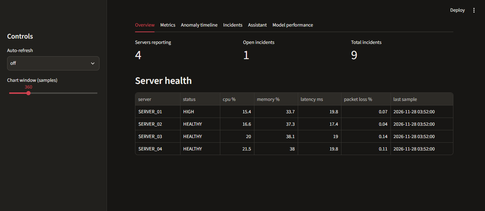
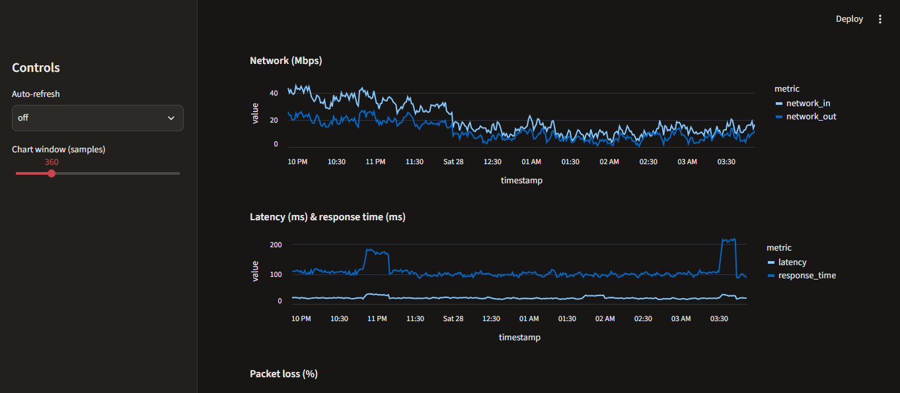
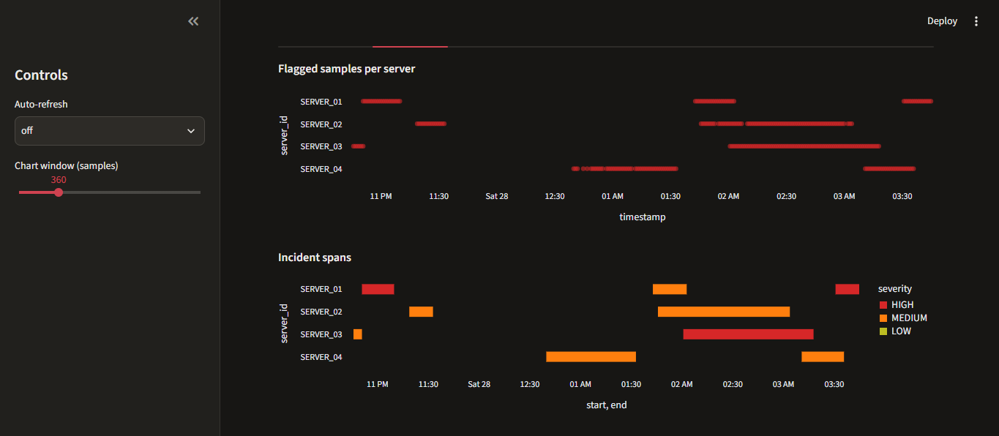
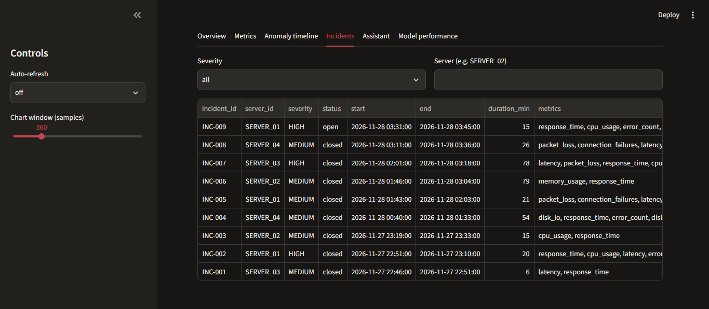
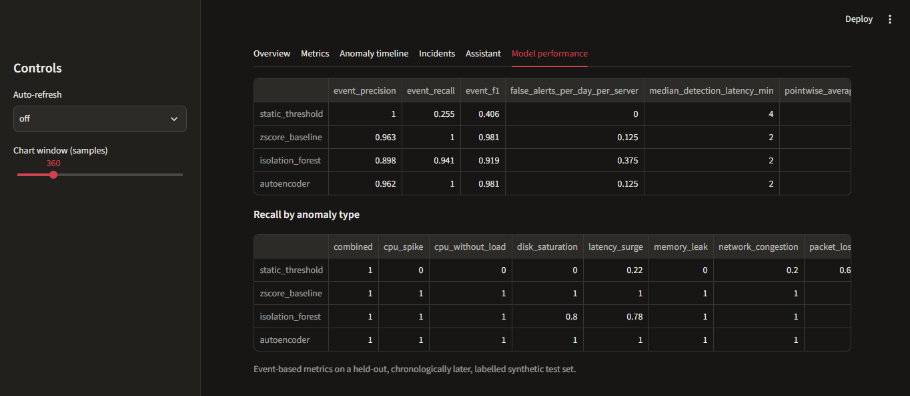

# InfraGuard AI


AI-powered infrastructure monitoring and anomaly detection (AIOps MVP): a telemetry simulator,
multivariate anomaly detection, incident grouping, a RAG troubleshooting assistant, a FastAPI backend and a
Streamlit dashboard. Everything runs on a laptop (CPU only).

> **Scope note.** Telemetry is *simulated*. Results below show the pipeline works and how methods compare on
> synthetic data; they are **not** measurements from a real environment. Detection is not root-cause analysis:
> every incident carries a *hypothesis*, never a confirmed cause.

## Screenshots

| Overview | Metrics |
|---|---|
|  |  |
| **Anomaly timeline and incident spans** | **Incidents** |
|  |  |



*Dashboard on simulated telemetry: server health, per-server metrics, flagged samples grouped into severity-rated
incidents, and the detector comparison on the labelled test set.*

## What is implemented (mapped to the plan)

| Plan layer | Where | Notes |
|---|---|---|
| 1 Telemetry generation | `src/infraguard/simulator.py` | 4 servers, 13 metrics, daily/weekly workload cycle, 8 labelled anomaly types, missing/invalid readings |
| 2 Data processing | `features.py` | cleaning without dropping rows, rolling means/max, slopes, % change, workload-normalised CPU, hour encoding |
| 3 Detection | `models.py`, `pipeline.py` | static threshold, hour-of-day z-score baseline, Isolation Forest, Autoencoder (Keras, or sklearn MLP fallback) |
| 4 Correlation | `correlation.py` | persistence filter, gap merging, per-metric attribution, sudden/gradual labels, severity rules, hypothesis |
| 5 AI assistant | `rag.py` | FAISS retrieval over `data/knowledge_base/*.md`, telemetry evidence, citations, "insufficient docs" fallback, optional LLM |
| 6 Backend | `api.py`, `db.py`, `service.py` | FastAPI + SQLAlchemy (PostgreSQL in Docker, SQLite locally) |
| 7 Dashboard | `dashboard/app.py` | overview, charts, anomaly timeline, incidents, assistant, model performance |
| Real-data evaluation | `scripts/evaluate_smd.py` | Server Machine Dataset (SMD): 28 real machines, event-based metrics |
| Evaluation | `evaluation.py`, `scripts/evaluate.py` | event-based precision/recall/F1, false alerts/day, detection latency, grouping ARI, alert reduction |

**Not implemented (diagram extras):** SNMP collection, CMDB/impact analysis, ticketing, auto-remediation, real log
parsing (only error/connection-failure counts are used). Treat them as future work.

## How incidents work

Detectors score every sample. Flags must persist for 3 samples to count, and flagged runs separated by 12 minutes or
less are merged into one incident (`MIN_CONSECUTIVE`, `MERGE_GAP` in `config.py`). Each incident records the abnormal
metrics, whether each moved suddenly or gradually, a rule-based severity (LOW/MEDIUM/HIGH from metric count, distance
from normal and duration), and a *hypothesis* with a suggested action. An incident stays **open** until 12 minutes pass
without new flags, so a server can still show an open incident just after its metrics look normal again. Incidents only
ever gain severity and metrics as the detection window slides. A detection with no single clearly abnormal metric is
capped at LOW and labelled low confidence.

## Quick start (local)

```bash
python -m venv .venv && source .venv/bin/activate      # Windows PowerShell: .\.venv\Scripts\Activate.ps1
pip install -r requirements.txt
pip install -r requirements-dl.txt          # optional: real Keras autoencoder (Windows: enable long paths first)
export PYTHONPATH=src                        # Windows PowerShell: $env:PYTHONPATH="src"

python scripts/generate_data.py              # train/val (normal) + test (labelled anomalies)
python scripts/train.py                      # trains on normal data, sets thresholds on normal validation data
python scripts/evaluate.py                   # compares all detectors, writes artifacts/eval_report.json
python scripts/evaluate_assistant.py         # assistant test set (retrieval + answer behaviour); --mode both for LLM

uvicorn infraguard.api:app --reload          # terminal 1  -> http://localhost:8000/docs
python scripts/stream_simulator.py           # terminal 2  -> replays telemetry with injected anomalies
streamlit run dashboard/app.py               # terminal 3  -> http://localhost:8501
pytest -q                                    # tests
```

### Docker (PostgreSQL + API + dashboard)

```bash
docker compose up --build            # first start simulates data, trains and evaluates inside the API container
python scripts/stream_simulator.py   # feed telemetry (export API_KEY in your shell if .env defines one)
# dashboard: http://localhost:8501    API docs: http://localhost:8000/docs
docker compose down                  # stop (data kept); add -v to wipe the database and the trained model
```

The image has no TensorFlow, so the autoencoder uses the sklearn fallback (build with `INSTALL_TF: "true"` for Keras).
Trained bundles are not portable between environments, which is why `artifacts/` is excluded from the image
(`.dockerignore`): retrain where you deploy.

## API

| Endpoint | Purpose |
|---|---|
| `POST /telemetry` | ingest samples (validated, idempotent) and run detection on a sliding window |
| `GET /metrics` | latest sample per server, or `?server_id=&limit=` history |
| `GET /anomalies` | flagged samples (`server_id`, `limit`) |
| `GET /incidents`, `GET /incidents/{id}` | grouped incidents (`server_id`, `severity`) |
| `POST /predict` | stateless detection on supplied samples (>= 15 per server) |
| `POST /assistant/query` | grounded troubleshooting answer with citations |
| `GET /model/report` | latest evaluation report |
| `GET /health` | DB / model / knowledge-base status |

Set `API_KEY` to require an `X-API-Key` header. Set `ANTHROPIC_API_KEY` for LLM-written answers
(`LLM_MODEL` configurable); without it the assistant returns an extractive answer built only from retrieved runbooks.

## Results from the included simulator (4 days x 4 servers, 51 injected events, default seeds)

| Model | Event precision | Event recall | False alerts / day / server | Median detection latency (min) | Grouping ARI |
|---|---|---|---|---|---|
| Static thresholds (CPU/mem >90%, latency >200 ms, loss >5%) | 1.00 | 0.26 | 0.00 | 4 | 0.03 |
| Hour-of-day z-score baseline | 0.96 | 1.00 | 0.13 | 2 | 0.67 |
| Isolation Forest | 0.90 | 0.94 | 0.38 | 2 | 0.16 |
| Autoencoder (Keras) | 0.96 | 1.00 | 0.13 | 2 | 0.52 |

Honest reading: fixed thresholds miss ~3 of 4 events; the simple workload-aware baseline is very strong on this
simulator; Isolation Forest is the weakest here and fragments some incidents (low ARI). Numbers vary with seeds
and will differ on real data. Re-run `scripts/evaluate.py` for your own figures.

## Real-data evaluation: Server Machine Dataset (SMD)

SMD (Su et al., KDD 2019) has 28 real server machines x 38 metrics (1-minute samples) with labelled anomaly segments;
the dataset is MIT-licensed. Setup and run:

```bash
git clone --depth 1 https://github.com/NetManAIOps/OmniAnomaly.git data/external/OmniAnomaly
python scripts/evaluate_smd.py --quick      # 4 machines
python scripts/evaluate_smd.py              # all 28 machines (writes artifacts/smd_report.json)
```

Protocol per machine: fit on the first 80% of the train half, set each threshold from the last 20% (99.5th percentile
of scores, chronological), then score the untouched test half. Events are runs of consecutive labelled samples;
alerts must persist >= 3 samples; an alert counts if it overlaps a true event (+/- 5 min). 327 true events in total.

| Detector | Event precision | Event recall | Event F1 | False alerts / machine-day | Median detection latency (min) |
|---|---|---|---|---|---|
| Global z-score (max abs deviation) | 0.31 | 0.59 | 0.40 | 1.25 | 2 |
| PCA reconstruction error | 0.22 | 0.73 | 0.34 | 2.24 | 2 |
| Isolation Forest | 0.14 | 0.39 | 0.21 | 2.09 | 2 |
| Autoencoder (sklearn MLP in this run) | 0.23 | 0.63 | 0.34 | 1.66 | 2 |

Honest reading: real data is much harder than the simulator. Every detector produces roughly 1-2 false alerts per
machine per day and none is precise. The simple z-score baseline is the best here, Isolation Forest is the weakest, and
the deep model does not beat linear baselines. SMD has no timestamps or incident ids, so hour-of-day baselines and
grouping metrics do not apply, and its 38 columns are unnamed. Metrics are strict event-level (no point-adjustment),
so they are not comparable to point-adjusted F1 scores quoted in papers. Do not tune on the test half.

## Assistant evaluation (30 questions)

`data/assistant_eval/questions.jsonl` holds 30 questions: 10 retrieval, 12 incident, and 8 honesty/safety cases
(root-cause overclaiming, unknown server, off-topic, prompt injection, secret requests). `scripts/evaluate_assistant.py`
pushes a controlled scenario (one known fault type per server) through the real ingest and detection pipeline into a
temporary database, then scores answers with rule-based checks: right runbook cited, valid `[KBn]` citations,
hypothesis wording, before/during numbers, "no incident" and "documentation insufficient" handling, forbidden phrases.

| Measure (TF-IDF + FAISS, extractive answers, no LLM) | Result |
|---|---|
| Retrieval recall@1 / recall@3 / MRR@3 (10 questions) | 0.80 / 1.00 / 0.88 |
| Answer-behaviour checks passed (20 questions) | 20 / 20 |
| Citation validity (cited ids are retrieved sources) | 100% |

Caveats: the question set was also used while fixing the assistant (query construction, investigation-step
inclusion, off-topic gate), so these figures are development-set results and are optimistic; extend the set with unseen
questions before quoting them. The off-topic gate is a lexical heuristic (share of question words found in the runbooks,
`OFF_TOPIC_MIN_COVERAGE`) calibrated on a small set; a near-miss such as a database-deadlock question sits close to the
cut-off. LLM mode is implemented but **not yet measured**: run `python scripts/evaluate_assistant.py --mode both` with
`ANTHROPIC_API_KEY` set to compare it with the extractive baseline.

## Known limitations / next steps

1. **Synthetic results are optimistic.** The simulator was written by the same author as the detectors; SMD above is
   the realistic picture. Next: windowed/LSTM models and better threshold strategies, tuned on validation data only.
2. Isolation Forest sees weak temporal context; add more trend features or a windowed/LSTM autoencoder.
3. Thresholds come from a quantile of normal validation scores (`THRESHOLD_QUANTILE` in `config.py`); tune on
   validation data, never on the test set.
4. Retrieval defaults to TF-IDF vectors in FAISS (no model download). `EMBEDDING_BACKEND=sbert` uses neural embeddings.
5. Add an assistant evaluation set (question -> expected runbook) to measure retrieval relevance and groundedness.
6. Add authentication beyond a shared API key, rate limiting and model versioning before any real deployment.

## Verified vs. not verified

Run and passing on Windows (Python 3.11, TensorFlow 2.21): data generation, training, evaluation, the 18-test unit/API
suite, and the Streamlit dashboard. The Docker Compose stack (PostgreSQL 16, API, dashboard) was run end to end on
Windows (Docker 29.9.3, Compose v5.7.1): telemetry streamed through the API produced incidents stored in PostgreSQL and
shown in the dashboard. The test suite also passes against a PostgreSQL 16 server (`TEST_DATABASE_URL`), and CI runs it
on SQLite and PostgreSQL plus a Docker smoke test.
**Not yet verified:** `sbert` embeddings and LLM mode (implemented, not measured). Real-data numbers below were produced
with the sklearn autoencoder fallback; rerun `scripts/evaluate_smd.py` locally to reproduce them with Keras.

Dashboard timestamps are UTC.

## License and data

Code: MIT (see `LICENSE`). Real-data evaluation uses the Server Machine Dataset (Su et al., "Robust Anomaly Detection
for Multivariate Time Series through Stochastic Recurrent Neural Network", KDD 2019), MIT-licensed, not redistributed here.